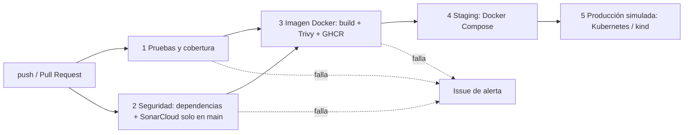

# Pagos — Microservicio de riesgo pagos

Microservicio correspondiente al **caso casoEjemplo — TicketWave** (Venta y control de acceso de entradas para eventos en vivo) de la Evaluación Parcial N°1.

| | |
|---|---|
| Stack | Spring Boot 3.5 · Java 21 · Maven · Spring Data JPA · H2 · springdoc-openapi |
| Calidad | JaCoCo cobertura LINE 100% · Cucumber (BDD) alineado a endpoints REST |
| Entrega | Docker / Docker Compose · Kubernetes · CI/CD con GitHub Actions |

## Responsabilidad (SRP)

administra los datos y la lógica del dominio de Pagos del caso casoEjemplo (TicketWave). Su base de datos es una **H2 en memoria** (un solo microservicio por base), cumpliendo aislamiento de datos por dominio.

## Página de presentación

Al ejecutar el servicio, `http://localhost:8080/` muestra la página de presentación del microservicio con documentación y enlaces a:

- **Swagger UI**: `/swagger-ui/index.html`
- **OpenAPI (yaml)**: `/v3/api-docs.yaml`
- **ReDoc**: `/redoc.html`
- **H2 Console**: `/h2-console`

## Endpoints

| Método | Ruta | Descripción |
|--------|------|-------------|
| GET | `/api/pagos` | Lista todos los recursos |
| GET | `/api/pagos/{id}` | Obtiene un recurso por id |
| POST | `/api/pagos` | Crea un recurso |
| PUT | `/api/pagos/{id}` | Actualiza un recurso |
| DELETE | `/api/pagos/{id}` | Elimina un recurso |

## Documentación del proyecto

La documentación completa está en la carpeta [`docs/`](docs/):

- [`docs/00_Resumen.md`](docs/00_Resumen.md) — propósito, responsabilidad y tecnologías
- [`docs/01_Arquitectura.md`](docs/01_Arquitectura.md) — componentes, arquitectura y patrones
- [`docs/02_API.md`](docs/02_API.md) — contrato REST y ejemplos curl
- [`docs/03_Pruebas.md`](docs/03_Pruebas.md) — tests unitarios, cobertura y Cucumber
- [`docs/04_Despliegue.md`](docs/04_Despliegue.md) — Docker, Docker Compose e integración

## Cómo ejecutar locmente

```bash
mvn spring-boot:run
```

## Cómo ejecutar con Docker

```bash
docker compose up --build
# http://localhost:8080
```

## Cómo ejecutar las pruebas

```bash
mvn test      # unit tests + Cucumber
mvn verify    # + verificación de cobertura JaCoCo (100% LINE, falla si baja)
```

## Pipeline CI/CD (Evaluación Parcial N°2)

El ciclo de vida completo del microservicio está automatizado en [`.github/workflows/ci-cd.yml`](.github/workflows/ci-cd.yml).



Cada etapa **bloquea a la siguiente** si falla (`needs:`), de modo que nada se publica ni se despliega sin pasar pruebas y seguridad.

| Evento | Qué ejecuta |
|---|---|
| Pull Request hacia `develop` / `main` | Etapas 1, 2 y 3 (revisión de dependencias; construye y escanea la imagen, **no** la publica ni despliega). SonarCloud no se ejecuta aquí (ver «Limitaciones conocidas») |
| Push a `develop` | Etapas 1 a 4 (publica la imagen y despliega en **staging**). Sin SonarCloud |
| Push a `main` | Etapas 1 a 5, **incluido SonarCloud con Quality Gate** (staging y luego **producción simulada**) |

### Dónde se evidencia cada requisito del encargo

| Requisito | Dónde está | Indicador |
|---|---|---|
| Dockerfile del microservicio | [`Dockerfile`](Dockerfile): multi-stage, JRE Alpine, usuario no root, healthcheck | IE1 |
| Construcción de imagen Docker en el pipeline | Job `docker` (Buildx + caché + etiquetas OCI) | IE1 |
| Pruebas unitarias automatizadas | Job `test`: JUnit + Cucumber con `mvn verify` | IE2 |
| Política de calidad (cobertura) | JaCoCo exige 100% de líneas en [`pom.xml`](pom.xml); si baja, el build falla | IE2 |
| Escaneo de dependencias | [`.github/dependabot.yml`](.github/dependabot.yml) + `dependency-review-action` en PR | IE3 |
| Análisis de código | SonarCloud con Quality Gate (job `seguridad`), ejecutado al hacer push a `main` | IE3 |
| Escaneo de la imagen | Trivy (bloquea con vulnerabilidades CRITICAL/HIGH); excepciones documentadas en [`.trivyignore`](.trivyignore) | IE3 |
| Alertas o bloqueos si falla la seguridad | Ver sección «Alertas y bloqueos» | IE3 |
| Despliegue automático en entorno simulado | Jobs `deploy-staging` (Compose) y `deploy-produccion` (Kubernetes en kind) | IE4 |
| Orquestación de contenedores | [`docker-compose.yml`](docker-compose.yml) y manifiestos en [`k8s/`](k8s/) | IE5 |

### Configuración previa (una sola vez)

1. **SonarCloud**: iniciar sesión con GitHub, importar el repositorio y desactivar *Automatic Analysis* (el análisis lo hace el pipeline). En el repositorio ir a *Settings → Secrets and variables → Actions* y crear:
   - Secret `SONAR_TOKEN` (token generado en SonarCloud).
   - Variables `SONAR_ORGANIZATION` y `SONAR_PROJECT_KEY` (aparecen en la configuración del proyecto en SonarCloud).
2. **Dependabot y grafo de dependencias**: habilitarlos en *Settings → Code security* (el grafo de dependencias es requisito de `dependency-review-action`).
3. **Protección de ramas** en `main` y `develop` (*Settings → Branches*): exigir Pull Request con una aprobación y que los checks `1 - Pruebas y cobertura`, `2 - Seguridad (SonarCloud y dependencias)` y `3 - Imagen Docker (build, escaneo y publicacion)` estén en verde antes de hacer merge. Esto vuelve **obligatorio** el bloqueo.
4. **Entornos** `staging` y `production`: se crean automáticamente en la primera ejecución. Opcionalmente se puede agregar aprobación manual en *Settings → Environments → production*.

### Cómo se garantiza la calidad

- Pruebas unitarias (JUnit) y de comportamiento (Cucumber) en cada push y Pull Request.
- Cobertura mínima de líneas del 100% verificada por JaCoCo; el reporte se adjunta a cada ejecución como artefacto y se resume en la pestaña *Summary*.
- Quality Gate de SonarCloud (`sonar.qualitygate.wait=true`): si no se cumple, el job falla. Se evalúa al hacer push a `main`.
- Revisión de dependencias en Pull Requests y actualizaciones semanales de Dependabot hacia `develop`, con el formato de commit del equipo (`chore(deps): ...`).
- Escaneo de la imagen con Trivy antes de publicarla.
- Pruebas de humo (*smoke tests*) después de cada despliegue: `/actuator/health` y `GET /api/pagos`.

### Cómo se garantiza la trazabilidad

El mismo commit se puede seguir desde el código hasta el entorno donde corre:

1. **Commit** → dispara la ejecución del workflow (visible en la pestaña *Actions*).
2. **Imagen** → se publica en GHCR con el tag inmutable `sha-<commit completo>` y con etiquetas OCI (`org.opencontainers.image.revision`, `source`, `created`). El resumen de la ejecución muestra el *digest*.
3. **Staging** → el pipeline verifica que la etiqueta `revision` de la imagen desplegada coincida con el commit que originó la ejecución.
4. **Kubernetes** → el Deployment queda anotado con `git-sha`, `pipeline-run` y `kubernetes.io/change-cause`.
5. **Historial de despliegues** → GitHub registra cada despliegue en *Environments* (`staging` / `production`).

Se despliega siempre la imagen que el pipeline construyó y escaneó (nunca `latest`).

### Parámetros de escalabilidad y seguridad

| Ámbito | Parámetro | Dónde |
|---|---|---|
| Seguridad | Permisos mínimos del `GITHUB_TOKEN` (`contents: read`, ampliado solo donde hace falta) | workflow |
| Seguridad | Umbral de bloqueo de Trivy (`CRITICAL,HIGH`), ajustable al ejecutar manualmente | workflow (`trivy_severity`) |
| Seguridad | Acción de Trivy fijada por SHA de commit, no por tag | workflow |
| Seguridad | Contenedor sin root, sin privilegios, sistema de archivos de solo lectura, sin capabilities | `Dockerfile`, `docker-compose.yml`, `k8s/deployment.yaml` |
| Escalabilidad | Límites y reservas de CPU/memoria | `docker-compose.yml` y `k8s/deployment.yaml` |
| Escalabilidad | HorizontalPodAutoscaler: 2 a 5 réplicas, objetivo 70% de CPU; mínimo ajustable al ejecutar manualmente | `k8s/hpa.yaml` (`replicas_min`) |
| Escalabilidad | Actualización sin caída (`maxUnavailable: 0`), sondas startup/readiness/liveness | `k8s/deployment.yaml` |
| Rendimiento | La JVM respeta el límite de memoria del contenedor (`MaxRAMPercentage`) y caché de capas/Maven en el build | `Dockerfile`, workflow |

Para cambiar estos parámetros sin tocar código: *Actions → CI/CD pagos-svc → Run workflow*.

### Caso real: vulnerabilidades detectadas por el pipeline

Al ejecutar el pipeline por primera vez, el escaneo de la imagen con Trivy **bloqueó la publicación** al detectar vulnerabilidades en las dependencias del microservicio, heredadas de la Evaluación 1 (Spring Boot 3.3.5, una versión sin soporte). Esto demuestra que el control de seguridad funciona. Se resolvió así:

| Hallazgo | Acción |
|---|---|
| Librerías de Spring Framework (varias HIGH) | Actualización de Spring Boot a 3.5.16 y de springdoc a 2.8.14 |
| Jackson (HIGH) y Tomcat embebido (CRITICAL) | Versiones fijadas en el `pom.xml` (`jackson-bom.version` y `tomcat.version`) a las que corrigen los CVE |
| `brotli-libs` de Alpine (CRITICAL) | `apk upgrade` en la imagen final del `Dockerfile` |
| `CVE-2026-47884` y `CVE-2026-47890` en `spring-webmvc` (CRITICAL) | Sin corrección gratuita en la línea 6.2 de Spring Framework (solo en 7.0.9, que requiere Spring Boot 4.x). Se aceptan temporalmente en [`.trivyignore`](.trivyignore), con justificación y fecha de vencimiento: la aplicación solo expone un `@RestController` y no usa `XsltView`, vistas ni Server-Sent Events |

Mejora futura: migrar a Spring Boot 4.x, que elimina la necesidad de las excepciones.

### Alertas y bloqueos

- **Bloqueo**: un fallo en pruebas, cobertura, Quality Gate, revisión de dependencias o Trivy detiene el pipeline antes de publicar o desplegar. Con la protección de ramas, además impide el merge del Pull Request.
- **Alerta**: si falla cualquier etapa en un push, el job `alerta-fallo` abre automáticamente un *Issue* con las etapas fallidas, el commit, el autor y el enlace a la ejecución. GitHub además notifica por correo las ejecuciones fallidas.

### Ejecutar el despliegue en local

Con Docker Compose:

```bash
docker compose up --build
curl http://localhost:8080/actuator/health
```

Con Kubernetes (requiere [kind](https://kind.sigs.k8s.io/) y `kubectl`):

```bash
docker build -t pagos-svc:local .
kind create cluster --name pagos
kind load docker-image pagos-svc:local --name pagos
sed "s|image: .*pagos-svc:.*|image: pagos-svc:local|" k8s/deployment.yaml | kubectl apply -f -
kubectl apply -f k8s/service.yaml -f k8s/hpa.yaml
kubectl rollout status deployment/pagos-svc
kubectl port-forward svc/pagos-svc 8080:80   # http://localhost:8080
```

### Limitaciones conocidas

- SonarCloud en su plan gratuito solo analiza la rama principal (`main`), por lo que el análisis y el Quality Gate se ejecutan al hacer push a `main` y no en los Pull Requests ni en `develop`.
- Las excepciones de `.trivyignore` son temporales (vencen el 2026-12-31) y deben revisarse al migrar a Spring Boot 4.x.
- El cluster `kind` del pipeline no incluye *metrics-server*, por lo que el HPA se aplica pero no escala por CPU en la simulación (en un cluster real sí lo haría).
- Los entornos son simulados: se crean y destruyen dentro del runner de GitHub Actions en cada ejecución.

## Declaración de uso de Inteligencia Artificial

- **Herramienta**: Anthropic. (2026). Claude Sonnet 5.5 [Modelo de lenguaje de gran tamaño]. https://claude.ai
- **Uso**: apoyo para generar una primera versión del Dockerfile, el workflow de GitHub Actions, los manifiestos de Kubernetes y la estructura del README; para explicar conceptos de Docker, CI/CD y Kubernetes; y para interpretar errores del pipeline (SonarCloud, Trivy) y proponer correcciones.
- **Validación**: el equipo no usó el contenido generado sin comprobarlo.
  - Se ejecutó `mvn verify` (pruebas y cobertura del 100%) y se levantó el servicio con Docker Compose, verificando `/actuator/health` y el estado `healthy` del contenedor.
  - Se configuraron manualmente SonarCloud, el token, los secretos y las variables en GitHub.
  - Se ajustó el pipeline según los fallos reales: el análisis de Sonar se limitó a `main` por el plan gratuito, y se corrigieron las vulnerabilidades que detectó Trivy (actualización de Spring Boot, Jackson, Tomcat y paquetes de Alpine; excepciones justificadas en `.trivyignore`).
## Conclusiones

### Reflexión de Gabriel Perez
mi aporte concreto consistió en adaptar, corregir y probar el Dockerfile y el archivo Compose), los manifiestos de Kubernetes, la ejecución de las pruebas locales y la configuración de SonarCloud, gestionando sus tokens y secretos.
Durante la integración del pipeline, me enfrenté a varios errores. Por ejemplo, SonarCloud no analizaba los PRs debido a las restricciones de su plan gratuito, y Trivy bloqueaba la ejecución por vulnerabilidades de seguridad, lo cual me costo (e irrito sinceramente) mucho, tuve que apoyarme en la IA para entender el origen de los fallos, pude solucionarlo restringiendo el análisis de Sonar a la rama main y gestionando las vulnerabilidades de Trivy mediante la actualización de versiones y la documentación de excepciones en el archivo .trivyignore.
Aprendi varias cosas con este proyecto, me acostumbré a trabajar correctamente con ramas y Pull Requests, tambien entiendo cómo funciona realmente el ciclo de vida de un pipeline y cómo orquestar contenedores con Kubernetes, algo que antes desconocía. Tambien me di cuenta que un bloqueo de seguridad puede aparecer por dependencias de un proyecto viejo y no necesariamente por mi código, algo que debi hacer antes de ocupar las herramientas que utilizamos fue revisar los limites del plan de estas

### Reflexión de Renato Martinez
mi participación en este proyecto me permitió conocer de manera más práctica cómo se construye y configura un pipeline CI/CD, entendiendo mejor la relación entre las distintas herramientas que se utilizan durante el desarrollo y despliegue de una aplicación. Durante el proceso surgieron dificultades al momento de integrar y configurar los servicios, ya que algunos errores no eran fáciles de identificar y fue necesario revisar las configuraciones y realizar distintas pruebas hasta encontrar una solución.
Una de las cosas que más aprendí fue la importancia de automatizar las tareas, ya que esto permite detectar errores con anticipación y tener un mayor control sobre los cambios que se realizan en un proyecto. También comprendí que la seguridad debe considerarse durante todo el proceso y no solamente cuando la aplicación ya está terminada, porque una vulnerabilidad puede impedir que el despliegue continúe. En general, considero que este trabajo fue una buena oportunidad para reforzar mis conocimientos, aprender a utilizar herramientas que se emplean en entornos reales y entender que, aunque al principio algunas configuraciones pueden resultar complejas, la práctica y la investigación son fundamentales para resolver los problemas que aparecen.

## Modelo de ramificacion elegido: Gitflow

- Usamos este modelo porque es el mas adecuado para el proyecto, se encarga de separar el codigo en desarrollo del codigo estable,  permite subir nuevas funciones sin ensuciar el codigo principal y
  facilita la correcion inmediata de fallos criticos.

  ## Convenciones y buenas prácticas del equipo

### 1. Convención de commits
Seguimos el formato estándar: `tipo(alcance): descripcion-corta` (en minúsculas y sin tildes).

| Tipo | Propósito | Ejemplo |
| :--- | :--- | :--- |
| `feat` | Nueva funcionalidad | `feat(ui): agregar pie de pagina` |
| `fix` | Corrección de bug | `fix(home): corregir titulo` |
| `docs` | Documentación | `docs: agregar changelog` |
| `chore` | Tareas de mantenimiento o CI/CD | `chore(ci): agregar workflow hola mundo` |

### 2. Naming de ramas
* Formato: `feature/<nombre>` y `hotfix/<nombre>`.
* Todo en minúsculas y con palabras separadas por guiones.
* Ejemplos: `feature/pagina-presentacion`, `hotfix/titulo-pagina`.

### 3. Flujo de merge
* Las ramas `feature/` y `hotfix/` siempre ingresan mediante Pull Request; nunca se realiza `push` directo a `main` ni a `develop`.
* Se exige al menos una aprobación obligatoria del compañero antes de realizar el merge.
* Se utiliza *merge commit* o *squash*, y la rama remota debe borrarse tras la integración.

### 4. Estrategia de revisión
* El autor abre el PR, completa la descripción y asigna formalmente a su compañero como revisor.
* El revisor examina la pestaña de cambios (*diff*), deja comentarios si es necesario y aprueba (*Approve*) antes de fusionar.
* Antes de solicitar revisión, se debe comprobar localmente que las pruebas del proyecto se ejecutan de manera satisfactoria.
